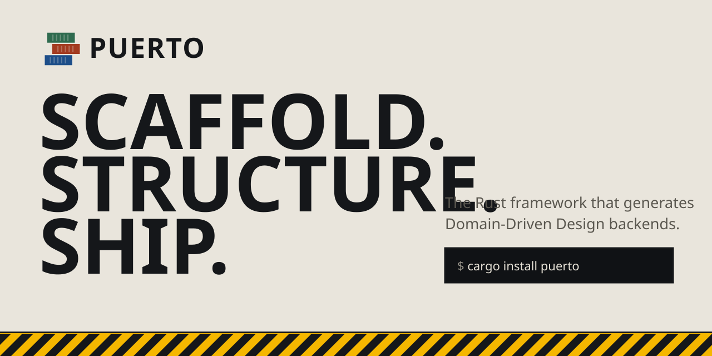

<p align="center">
  
</p>

<p align="center">
  
  
  
  
</p>

---

A Rust full-stack framework that brings the **delightful developer experience** of Laravel and Ruby on Rails to a **Domain-Driven Design** architecture.

---

## Core Principles

### 1. Delightful Coding Experience

Getting started should take seconds, not hours. `puerto new my-app` gives you a production-ready workspace with the right structure, dependencies, and conventions already in place. No boilerplate, no decision fatigue.

### 2. Truly AI-Ready

Puerto is built for the age of AI-assisted development. Rust's strict compiler acts as an **instant feedback loop** — when an AI agent generates wrong code, the compiler catches it with a precise, actionable error. No silent failures, no runtime surprises. The stronger the types, the smarter the agent.

### 3. Convention over Configuration

Puerto makes the right choices for you. Directory layout, error patterns, dependency injection, testing conventions — all standardized. When every Puerto project looks the same, AI agents and human developers can navigate any codebase from day one.

---

## Why DDD Instead of MVC

MVC is a great starting point, but it doesn't scale well. As applications grow, business logic leaks into controllers and models, making code harder to test and reason about.

Puerto generates projects around **Domain-Driven Design** and **Clean Architecture**:

- **Domain** is pure Rust — no framework dependencies, no infrastructure concerns. Business rules live here.
- **Application** orchestrates the domain — use cases are explicit, testable units of behavior.
- **Infrastructure** adapts external systems (databases, HTTP clients) to domain contracts.
- **Presentation** exposes the application via HTTP — it's just another adapter.

The result: a codebase where business logic is isolated, always testable, and never coupled to the framework.

---

## Architecture

Every Puerto project is a Cargo workspace with three crates, plus a React frontend (`--no-web`
skips it):

```
my-app/
├── business/          # Pure Rust — domain models, errors, use cases
│   └── src/
│       ├── domain/    # Entities, repository traits, use case traits
│       └── application/ # Use case implementations
├── infrastructure/    # Adapters — repositories, HTTP clients, etc.
│   └── src/
├── presentation/      # HTTP API — poem-openapi routes, DTOs, error mapping
│   └── src/
└── web/               # React 19 + daisyUI on Bun — typed from the API's OpenAPI spec
    └── src/           # domain/ · infrastructure/ (HTTP adapters) · presentation/ (screens)
```

**Dependency rule (inward only):**

```
Presentation → Infrastructure → Application → Domain
```

The domain depends on nothing. Everything else depends on the domain. `web/` follows the same
rule, checked by dependency-cruiser.

Every generated entity also gets, out of the box:

- **Its own id type** (`ProductId`), so another entity's id cannot be passed by mistake
- **One repository error** (`RepositoryError`: `Duplicate`, `InvalidData`, `Unavailable`) that its
  own error converts — a unique violation in Postgres answers `409`
- **Paged lists** — `GET /products?limit=&offset=` answers `{ items, total, limit, offset }`, 20 per
  page by default and capped at 100 in the domain

---

## Getting Started

```bash
# Install Puerto (--locked: build with the tested dependency versions)
cargo install puerto --locked

# Scaffold a new project
puerto new --name my-app

# Enter the project and run
cd my-app
make run
```

Visit `http://localhost:8080` for the Swagger UI, or call the API directly:

```bash
curl http://localhost:8080/api/greetings/World
```

### Web frontend

`puerto generate scaffold <Name>` also writes the entity's screens — list, detail and a
create/edit form, with an HTTP repository and `bun test` tests — and every field type gets its
input. The OpenAPI spec is the contract between the two halves:

```bash
make web/sync                    # after a scaffold or a DTO change: export the spec, regenerate the web types
make web/install && make web/dev # http://localhost:5173, /api proxied to :8080
```

`puerto generate web <Name>` writes the screens alone, for an entity already in `puerto.toml`.

### Entity Fields

Scaffold entities with typed fields — the type system flows from `puerto.toml` through all layers:

```bash
puerto generate scaffold Product -- name:String price:i64! sku:String
```

This creates a `Product` entity with custom fields in `puerto.toml`, and generates typed structs in every DDD layer (domain model, DTOs, repository rows, SQL migrations). Supported types include `String`, `i64`, `bool`, `f64`, `Uuid`, `DateTime<Utc>`, `Option<T>`, `Vec<T>`, and `HashMap<String, String>`. Append `!` to mark a field as unique (e.g., `sku:String!`).

### Value Objects

Wrap primitive fields in strongly-typed Value Objects — generated across all layers automatically:

```bash
# Regular VO
puerto generate scaffold Order -- amount:Amount:f64 status:Status:enum:Pending/Confirmed/Cancelled

# Nullable / array VOs
puerto generate scaffold User -- email:Email:String nickname:Nick:opt:String tags:Tag:vec:String

# Shared VOs — declared once, reusable across entities
puerto generate value-object Email String
puerto generate scaffold User -- email:Email   # type inferred from the shared VO declaration
```

Each VO generates a domain struct with private inner value, `new()` returning `Result`, and `value()` / `as_str()` accessors. Enum VOs implement `FromStr` (`"Active".parse::<Status>()`) and `as_str()`. Infrastructure and presentation layers use primitives; VOs are constructed and extracted at the boundary automatically.

### Domain events

A project with a database can record an event with every write — saved with the entity in one
transaction, in an outbox table ([ADR-0018](docs/adr/0018-domain-events-outbox-pluggable-transport.md)):

```bash
puerto new --name shop --db --events db        # or --events kafka
puerto generate scaffold Product -- name:String sku:String!
puerto generate event Product product_published
puerto generate consumer notify_new_product --on product_created,product_published
make worker                                    # relays the outbox, runs the consumers (:8081)
```

Each CRUD entity gets a generated `events.rs` (`ProductEvent::Created(ProductSnapshot)`, …) and a
unit of work; its repository only reads, so a write that skips the outbox does not compile. A
second binary, `worker/`, relays the outbox and runs the consumers: each is an `EventHandler`
that answers `Ack`, `Retry` (redelivered with backoff) or `DeadLetter` — nothing is dropped
without a row in `dead_letters` (`make events/dead-letters`). Delivery is at-least-once, so
handlers must be idempotent. The `db` transport needs no broker. On Kafka (`--events kafka`) the
worker publishes each event to its aggregate's topic, keyed by the aggregate id, and each consumer
is a consumer group — `docker-compose.yml` runs Redpanda for development.

Validate your `puerto.toml` at any time:

```bash
puerto validate
```

Visit `http://localhost:8080` for the Swagger UI, or call the API directly:

```bash
curl http://localhost:8080/api/greetings/World
```

---

## Project Structure (Puerto itself)

Puerto is also a Cargo workspace:

```
puerto/
└── crates/
    ├── cli/                # The puerto binary (cargo-generate wrapper)
    │   ├── src/            # CLI source
    │   └── template/       # The "basic" project template (edit directly here)
    ├── core/               # puerto-core — runtime: RepositoryError, PageRequest / Page<T>,
    │                       #   domain events (envelope, delivery policy, transport ports)
    ├── web/                # puerto-web — runtime: server, Config, health probes, ErrorResponse
    ├── sqlx/               # puerto-sqlx — runtime: Postgres pool, migrations, ping, map_sqlx_error,
    │                       #   unit of work, outbox and the db event transport
    └── events/             # puerto-events — runtime: the worker's relay, consume loops, health
                            #   probes and graceful shutdown
```

What every generated project shares is not copied into it: it depends on the runtime crates, on the
same minor as the CLI that generated it, and receives their fixes through `cargo update`
([ADR-0017](docs/adr/0017-runtime-crates-next-to-the-generator.md)).

| Command          | Description                                                |
| ---------------- | ---------------------------------------------------------- |
| `make run`       | Run the puerto CLI                                         |
| `make test`      | Fast structural tests                                      |
| `make test/full` | Full test: generates projects + runs their clippy and tests     |
| `make test/db`   | Same for a `--db` project, against a throwaway Postgres    |
| `make test/mutation` | Mutation testing (cargo-mutants) on Puerto's pure logic |
| `make lint`      | Clippy with `-D warnings`                                  |
| `make format`    | rustfmt                                                    |
| `make check`     | cargo check                                                |
