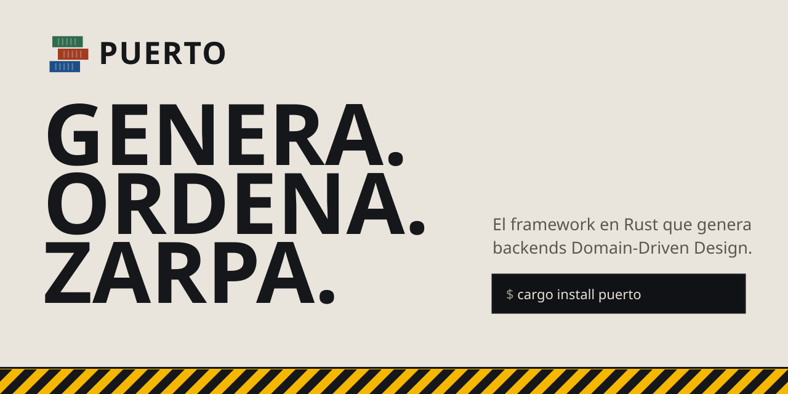

<p align="center">
  
</p>

<p align="center">
  <a href="https://puerto-rs.vercel.app/docs/"></a>
  <a href="https://crates.io/crates/puerto"></a>
  
  
  
</p>

<p align="center">
  <b><a href="https://puerto-rs.vercel.app">Web</a></b> ·
  <b><a href="https://puerto-rs.vercel.app/docs/start/quick-start/">Empezar</a></b> ·
  <b><a href="https://puerto-rs.vercel.app/docs/">Documentación</a></b> ·
  <b><a href="https://puerto-rs.vercel.app/docs/decisions/">Decisiones</a></b>
</p>

---

Un framework full-stack en Rust que lleva la **experiencia de desarrollo** de Laravel y Ruby on
Rails a una arquitectura de **Domain-Driven Design**.

---

## Principios

### 1. Programar a gusto

Empezar tiene que costar segundos, no horas. `puerto nuevo --nombre mi-app` te da un workspace
listo para producción, con la estructura, las dependencias y las convenciones ya puestas. Sin
boilerplate ni decisiones que tomar el primer día.

### 2. Hecho para la IA

Puerto está pensado para programar con agentes. El compilador estricto de Rust es un **bucle de
corrección inmediato**: cuando un agente escribe código incorrecto, el compilador lo para con un
error preciso que dice qué arreglar. Nada falla en silencio ni sorprende en ejecución. Cuanto más
fuertes los tipos, mejor trabaja el agente.

### 3. Convención antes que configuración

Puerto elige por ti. La estructura de directorios, los errores, la inyección de dependencias, las
convenciones de tests: todo es estándar. Si todos los proyectos Puerto se parecen, personas y
agentes se mueven por cualquiera desde el primer día.

---

## Por qué DDD y no MVC

MVC es un buen punto de partida, pero no escala bien. Cuando la aplicación crece, la lógica de
negocio se escapa a los controladores y a los modelos, y el código se vuelve difícil de probar y de
entender.

Puerto genera los proyectos en torno a **Domain-Driven Design** y **Clean Architecture**:

- **Dominio**: Rust puro, sin dependencias del framework ni de la infraestructura. Aquí viven las
  reglas de negocio.
- **Aplicación**: orquesta el dominio. Los casos de uso son unidades de comportamiento explícitas y
  que se pueden probar.
- **Infraestructura**: adapta los sistemas externos (bases de datos, clientes HTTP) a los contratos
  del dominio.
- **Presentación**: expone la aplicación por HTTP. Es un adaptador más.

El resultado: un código donde la lógica de negocio está aislada, siempre se puede probar y nunca
depende del framework.

---

## Arquitectura

Cada proyecto Puerto es un workspace de Cargo con un crate por contexto y capa
([ADR-0023](docs/adr/0023-crates-por-contexto-y-capa.md)), más un frontend React (`--sin-web` lo
quita). Todo lo que genera Puerto está en castellano: tipos, funciones, rutas, JSON, códigos de
error, tests y pantallas ([ADR-0024](docs/adr/0024-lo-generado-en-castellano.md)); cada nombre sale
de [el glosario](docs/glosario.md).

```
mi-app/
├── nucleo/                 # Objetos valor compartidos, sin E/S
├── contextos/
│   └── producto/           # Un contexto por entidad
│       ├── dominio/        # dominio_producto: modelo, errores, puerto del repositorio, eventos
│       ├── aplicacion/     # aplicacion_producto: un fichero por caso de uso, con sus tests
│       ├── infraestructura/ # infra_producto: adaptadores en memoria o Postgres
│       └── rest/           # rest_producto: rutas poem-openapi, DTO, errores HTTP
├── presentacion/
│   ├── cableado/           # La raíz de composición, generada desde puerto.toml
│   └── api/                # El binario (+ worker/ con eventos de dominio)
├── migraciones/ + migrador/ # Todas las migraciones SQL y el MIGRADOR (--db)
└── web/                    # React 19 + daisyUI sobre Bun, tipado desde la especificación OpenAPI
```

**Regla de dependencias (solo hacia dentro), que impone Cargo:**

```
rest_<c> → aplicacion_<c> → dominio_<c> → nucleo, puerto-nucleo
infra_<c> → dominio_<c>
cableado, api, worker → todo lo anterior
```

El dominio no depende de nada del workspace. Una referencia entre entidades
(`cliente_id:ref:Cliente`) es una dependencia entre sus crates de dominio, así que Cargo rechaza
un ciclo. `web/` sigue la misma regla, que comprueba dependency-cruiser.

Además, cada entidad generada trae de serie:

- **Su propio tipo de id** (`IdProducto`), para que no se pueda pasar por error el id de otra
  entidad
- **Un solo error de repositorio** (`ErrorRepositorio`: `Duplicado`, `DatosInvalidos`,
  `NoDisponible`, `ReferenciaInexistente`) que convierte su propio error: un único violado en
  Postgres responde `409`
- **Listas paginadas**: `GET /productos?limite=&desplazamiento=` responde
  `{ elementos, total, limite, desplazamiento }`, 20 por página por defecto y como mucho 100, que
  acota el dominio

---

## Empezar

```bash
# Instala Puerto (--locked: compila con las versiones de dependencias probadas)
cargo install puerto --locked

# Crea un proyecto
puerto nuevo --nombre mi-app

# Entra y arráncalo
cd mi-app
make run
```

Abre `http://localhost:8080` para ver la Swagger UI, o llama a la API directamente:

```bash
curl http://localhost:8080/api/saludos/Mundo
```

### El frontend web

`puerto generar scaffold <Nombre>` también escribe las pantallas de la entidad: lista, detalle y
un formulario para crear y editar. Son contenedores que llaman al cliente tipado de la API, vistas
que solo reciben props y tests de `bun test` contra una API falsa; cada tipo de campo tiene su
input. Un formulario rechazado dice qué falló junto al campo (`contextos/<entidad>/mensajes.ts`,
generado de los mismos códigos que `errores.rs`), y la página de una lista va en la URL. La
especificación OpenAPI es el contrato entre las dos mitades:

```bash
make web/sync                    # tras un scaffold o un cambio de DTO: exporta la especificación, regenera los tipos de la web
make web/install && make web/dev # http://localhost:5173, con /api redirigido a :8080
```

`puerto generar web <Nombre>` escribe solo las pantallas, para una entidad que ya está en
`puerto.toml`. El frontend también va en castellano: nombres, rutas, textos y tests.

Las pantallas base (el acceso, el marco, el panel, el perfil) y el tema tienen otras variantes, y
un SaaS puede llevar una portada pública (`puerto nuevo --portada`) con sus secciones:
`puerto generar web-bloque` las lista y `puerto generar web-bloque <hueco>/<variante> --forzar`
instala una. Todas, pintadas y con su código, en [el escaparate](https://puerto-rs.vercel.app/bloques/).

### Los campos de una entidad

Crea entidades con campos tipados; los tipos van de `puerto.toml` a todas las capas:

```bash
puerto generar scaffold Producto -- nombre:String precio:i64 sku:String!
```

Esto declara la entidad `Producto` con sus campos en `puerto.toml` y genera structs tipados en cada
capa (modelo de dominio, DTO, filas del repositorio, migraciones SQL). Los tipos admitidos son
`String`, `i64`, `bool`, `f64`, `Uuid`, `DateTime<Utc>`, `Option<T>`, `Vec<T>` y
`HashMap<String, String>`. Un `!` al final marca el campo como único (p. ej. `sku:String!`);
`--unico jugador_id,partido_id` crea un único sobre varios campos, y `--orden=-puntos,nombre` fija
el orden de la lista.

### Objetos valor

Envuelve los campos primitivos en objetos valor con su propio tipo, generados en todas las capas:

```bash
# Objeto valor normal
puerto generar scaffold Pedido -- importe:Importe:f64 estado:Estado:enum:Pendiente/Confirmado/Cancelado

# Objetos valor opcionales y listas
puerto generar scaffold Cliente -- email:Email:String apodo:Apodo:opt:String etiquetas:Etiqueta:vec:String

# Objetos valor compartidos: se declaran una vez y los usan varias entidades
puerto generar objeto-valor Email String
puerto generar scaffold Cliente -- email:Email   # el tipo sale de la declaración compartida
```

Cada objeto valor genera un struct de dominio con el valor interno privado, un `new()` que
devuelve `Result` y un `valor()` / `as_str()` para leerlo. Los enum implementan `FromStr`
(`"Activo".parse::<Estado>()`) y `as_str()`. La infraestructura y REST usan primitivos; los objetos
valor se construyen y se deshacen en el borde.

### Referencias

Una entidad que pertenece a otra guarda su id, nunca el agregado
([ADR-0022](docs/adr/0022-references-are-typed-ids-checked-by-foreign-keys.md)):

```bash
puerto generar scaffold Cliente -- nombre:String
puerto generar scaffold Pedido -- cliente_id:ref:Cliente revisor_id:ref:opt:Cliente
```

`Pedido.cliente_id` es un `IdCliente`, así que los ids de dos entidades no se pueden intercambiar.
Con `--db`, la columna tiene una clave foránea: un pedido de un cliente que no existe es un `422`
en `cliente_id`. La lista filtra por ella (`GET /pedidos?clienteId=`), y el formulario web elige el
cliente en un `<select>`.

### Eventos de dominio

Un proyecto con base de datos puede registrar un evento con cada escritura, guardado junto a la
entidad en una sola transacción, en una tabla outbox
([ADR-0018](docs/adr/0018-domain-events-outbox-pluggable-transport.md)):

```bash
puerto nuevo --nombre tienda --db --eventos db   # o --eventos kafka
puerto generar scaffold Producto -- nombre:String sku:String!
puerto generar evento Producto producto_publicado
puerto generar consumidor avisar_producto_nuevo --tras producto_creado,producto_publicado
make worker                                      # saca los eventos del outbox y ejecuta los consumidores (:8081)
```

Cada entidad CRUD recibe un `eventos.rs` generado (`EventoProducto::Creado(SnapshotProducto)`, …)
y una unidad de trabajo; su repositorio solo lee, así que una escritura que se salta el outbox no
compila. Un segundo binario, `presentacion/worker/`, saca los eventos del outbox y ejecuta los
consumidores: cada uno es un `ManejadorEvento`, construido una vez con el pool de la base de datos
(`construir(pool)`, donde toma los casos de uso a los que llama), que responde `Ack`, `Reintentar`
(se vuelve a entregar con espera) o `Descartar`; nada se retira sin una fila en `descartados`
(`make eventos/descartados`). La entrega es al menos una vez, así que los consumidores tienen que
ser idempotentes. El transporte `db` no necesita broker. Con Kafka (`--eventos kafka`), el worker
publica cada evento en el topic de su agregado, con el id del agregado como clave, y cada
consumidor es un grupo de consumidores; `docker-compose.yml` arranca Redpanda para desarrollo.
Compilar un proyecto Kafka compila librdkafka desde el código fuente: necesita `cmake` y las
cabeceras de libcurl (`libcurl4-openssl-dev` en Debian/Ubuntu, `curl` en Arch, ya instaladas con
Xcode en macOS).

### Correo

Un correo es un puerto en el dominio, una implementación con plantillas en la infraestructura y
tres ficheros de plantilla; se escriben una vez y desde entonces son tuyos
([ADR-0020](docs/adr/0020-mail-port-per-mail-sent-from-the-worker.md)):

```bash
puerto generar correo bienvenida -- nombre:String plan:opt:String       # cualquier proyecto
puerto generar correo bienvenida --tras cliente_creado --para email     # proyectos con eventos: lo envía el worker
make correo/ui                                                          # Mailpit: cada correo enviado en desarrollo
```

`contextos/correo/dominio/src/bienvenida.rs` tiene `CorreoBienvenida` y el puerto
`EnviadorCorreoBienvenida`; `contextos/correo/infraestructura/src/bienvenida.rs` renderiza
`contextos/correo/infraestructura/plantillas/bienvenida/{asunto.txt, cuerpo.html, cuerpo.txt}`
(minijinja, estricto) y envía por SMTP. Sus tests renderizan cada plantilla, así que una errata
hace fallar `make test`. Con `--tras`, `presentacion/worker/src/consumidores/correo_bienvenida.rs`
construye el correo con el snapshot del evento y lo envía una vez por evento: una fila de
`correos_enviados` por evento evita que una reentrega lo vuelva a enviar, un 5xx se descarta, y un
4xx o un servidor caído se reintentan. En desarrollo, Mailpit (`docker-compose.yml`) recoge todos
los correos; en producción se pone `SMTP_URL`.

### Auth

`puerto nuevo --auth oidc` comprueba los tokens de un proveedor OpenID Connect (Auth0, Keycloak;
Keycloak corre en `docker-compose.yml` para desarrollo); `--auth local` (con `--db`) guarda las
cuentas y las sesiones en la base de datos del proyecto, con `POST /auth/registro`, `/auth/login`
y `/auth/logout` ([ADR-0021](docs/adr/0021-auth-one-authenticator-port-oidc-or-local.md)). Las
rutas piden token por defecto; `scaffold --publico listar_productos` abre una,
`--rol borrar_producto=admin` añade `#[requiere_rol("admin")]` a su handler, y `--privado email`
deja un campo fuera de lo que una ruta pública responde a quien llama sin sesión.

Valida tu `puerto.toml` cuando quieras:

```bash
puerto validar
```

---

## La estructura de Puerto

Puerto también es un workspace de Cargo:

```
puerto/
└── crates/
    ├── cli/                # El binario puerto (sobre cargo-generate)
    │   ├── src/            # El código de la CLI
    │   └── template/       # La plantilla de los proyectos (se edita aquí)
    ├── nucleo/             # puerto-nucleo, runtime: ErrorRepositorio, PeticionPagina / Pagina<T>,
    │                       #   eventos de dominio (sobre, política de entrega, puertos del
    │                       #   transporte), los puertos del correo y el de auth
    ├── macros/             # puerto-macros: #[requiere_rol], que se usa a través de puerto-web
    ├── web/                # puerto-web, runtime: servidor, Config, sondas de salud, RespuestaError,
    │                       #   BearerAuth
    ├── sqlx/               # puerto-sqlx, runtime: pool de Postgres, migraciones, ping,
    │                       #   mapear_error_sqlx, unidad de trabajo, outbox, el transporte db de
    │                       #   eventos, sesiones y credenciales
    ├── eventos/            # puerto-eventos, runtime: el relay del worker, los bucles de consumo,
    │                       #   las sondas de salud y el apagado ordenado
    ├── kafka/              # puerto-kafka, runtime: el transporte Kafka de eventos
    ├── correo/             # puerto-correo, runtime: envío SMTP, plantillas, enviar una vez
    └── auth/               # puerto-auth, runtime: el autenticador OIDC, el hash de contraseñas argon2
```

Lo que comparten todos los proyectos generados no se copia en ellos: dependen de los crates del
runtime, en la misma minor que la CLI que los generó, y reciben sus arreglos con `cargo update`
([ADR-0017](docs/adr/0017-runtime-crates-next-to-the-generator.md)).

| Comando              | Qué hace                                                                     |
| -------------------- | ---------------------------------------------------------------------------- |
| `make run`           | Ejecuta la CLI puerto                                                        |
| `make test`          | Tests estructurales rápidos                                                  |
| `make test/full`     | El test completo: genera proyectos y ejecuta su clippy y sus tests           |
| `make test/db`       | Lo mismo para un proyecto `--db`, contra un Postgres + Mailpit desechables   |
| `make test/kafka`    | El transporte Kafka contra un Redpanda desechable (+ Postgres, Mailpit)      |
| `make test/mail`     | El adaptador SMTP contra un Mailpit desechable                               |
| `make test/auth`     | El adaptador OIDC y un proyecto OIDC contra un Keycloak + Postgres desechables |
| `make test/mutation` | Tests de mutación (cargo-mutants) sobre la lógica pura de Puerto             |
| `make lint`          | Clippy con `-D warnings`                                                     |
| `make format`        | rustfmt                                                                      |
| `make check`         | cargo check                                                                  |
